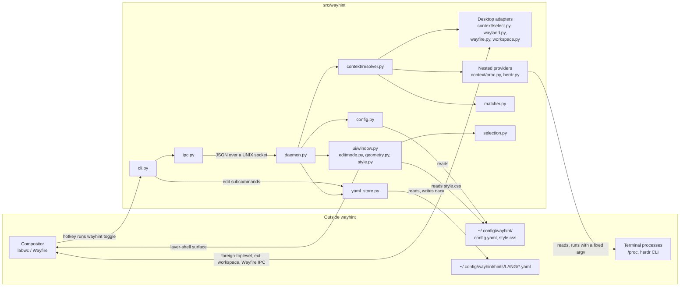
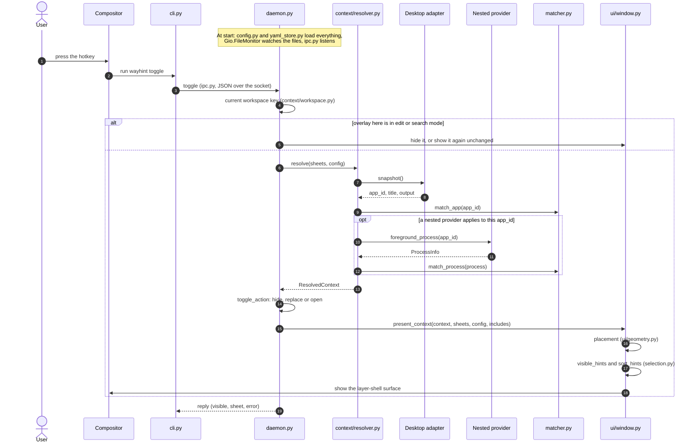

# ARCHITECTURE — wayhint の構成

[English](ARCHITECTURE.md)

生成時点: 9da2d5e(2026-10-11)

コードを読む前の見取り図。どんなモジュールがあり、何に依存しているか、hotkey を押してから
ヒントが画面に出るまでの道筋を示す。境界の決まり(どのモジュールが何を呼んでよいか、その理由)は
[`dev-docs/DESIGN.md`](../dev-docs/DESIGN.ja.md) にあり、ここではそれを図にしているだけである。

## モジュール構成

矢印は呼ぶ側・読む側から、呼ばれる側・読まれる側へ向く。`~` で始まるもの以外のパスは
`src/wayhint/` の下。`models.py`(共通のデータ型)はほぼすべてのモジュールが import するので、
図が読めなくならないよう省いている。

| ノード | パス | 役割 |
|---|---|---|
| cli.py | `cli.py` | `wayhint` コマンド。daemon への表示コマンド送信、コマンドラインからのシート編集、`check-sheet`、`inspect` |
| ipc.py | `ipc.py` | socket のパス、JSON の符号化、両側で共有するクライアントと要求の処理 |
| daemon.py | `daemon.py` | `wayhintd`。GTK アプリケーション本体で、読み込んだ設定とシートを持ち、ファイルを監視し、コマンドに答える |
| config.py | `config.py` | `config.yaml` を `GlobalConfig` に読む |
| yaml_store.py | `yaml_store.py` | シートの読み込みと検査(最後に正しかった版を保持)、`include` の解決、編集の書き戻し |
| context/resolver.py | `context/resolver.py` | 「いま手前にあるもの」を `ResolvedContext`(window、端末内のプロセス、使うシート、出力先)にする |
| Desktop adapters | `context/select.py`、`context/wayland.py`、`context/wayfire.py`、`context/workspace.py` | コンポジタとのやり取り。アクティブな window と output、focus、現在の workspace |
| Nested providers | `context/proc.py`、`context/herdr.py` | 端末の中で前面にいるプロセスを `/proc` から、または Herdr に聞いて求める |
| matcher.py | `matcher.py` | app_id やプロセスに `match` が合うシートを選ぶ |
| selection.py | `selection.py` | 親シートや include のヒントを混ぜ、並べ、検索する |
| ui/window.py | `ui/window.py`、`ui/editmode.py`、`ui/geometry.py`、`ui/style.py` | ヒント画面。配置、一覧、検索と編集モード |

図に無いもの: `editor.py`(ヒントをエディタで開く)、`clipboard.py`、`state.py`(検索語の記憶)、
`i18n.py`(UI の文言)、`schema.py` と `sheet_check.py`(`check-sheet` と JSON schema の中身)。
`demo/` と `tools/demo/` は紹介動画を撮るための補助ツールで、製品には含まれない。

## hotkey を押してから表示まで

`wayhintd` はコンポジタの autostart で一度だけ起動する。起動時に `config.yaml` と全シートを読み、
それらの監視を始め、socket で待つ。コマンドが来るまで何も調べ直さない。hotkey を押すと次のように
進む(`toggle` コマンドの場合。`show` と `refresh` も resolve 以降は同じ道筋)。

| 段階 | パス | 何が起きるか |
|---|---|---|
| Hotkey | コンポジタの設定、`cli.py` | コンポジタの keybind が `wayhint toggle` を実行する。cli はコマンドを転送するだけ |
| Dispatch | `ipc.py`、`daemon.py` | daemon が要求を解読し `Daemon.toggle` を呼ぶ |
| Workspace | `context/workspace.py` | 押された hotkey がどの workspace のものかを決める。開いているヒント画面は workspace ごとに持つ |
| Resolve | `context/resolver.py` | focus 中の window を一度だけ調べ、`ResolvedContext` にする |
| Desktop | `context/select.py`、`context/wayland.py`、`context/wayfire.py` | focus 中の window の app_id、タイトル、output を返す |
| Nested | `context/proc.py`、`context/herdr.py` | 端末なら、前面で動いているコマンドを求める |
| Match | `matcher.py` | window のシートを選び、プロセスのシートがあればそちらを選ぶ |
| Draw | `ui/window.py`、`ui/geometry.py`、`selection.py` | surface を配置し、親や include のヒントも混ぜて一覧を出す |

シートの選ばれ方と他のシートのヒントの混ざり方は [`docs/SHEETS.md`](SHEETS.ja.md)、各状態で
hotkey が何をするかは [`docs/HOTKEYS.md`](HOTKEYS.ja.md) にある。
