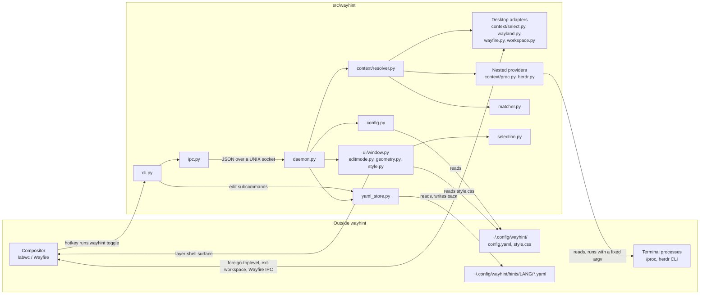
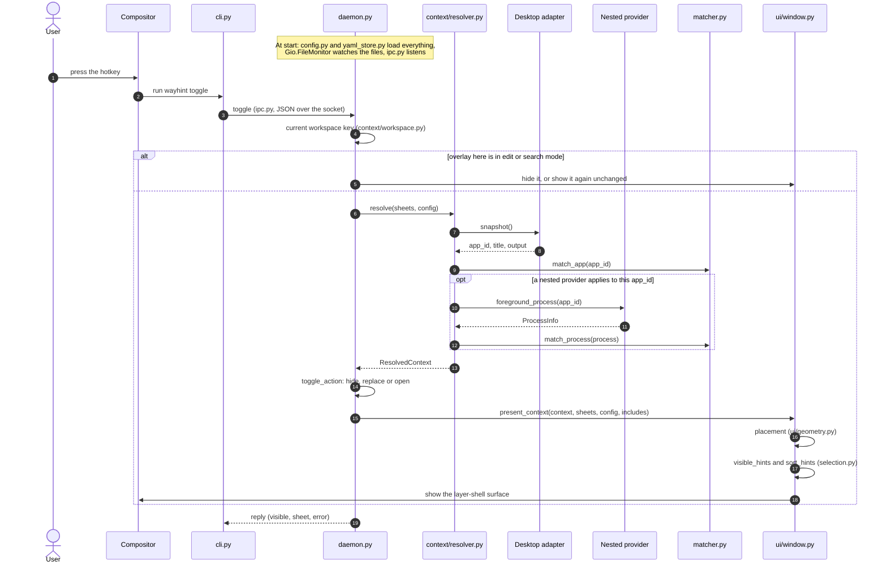

# ARCHITECTURE — how wayhint is put together

[日本語](ARCHITECTURE.ja.md)

Generated at: 9da2d5e (2026-10-11)

An overview to read before the code: which modules there are, what they depend on, and the path
from a hotkey press to hints on screen. The rules behind the boundaries (which module may call
what, and why) are in [`dev-docs/DESIGN.md`](../dev-docs/DESIGN.md); this page only draws them.

## Module structure

Arrows point from the caller to what it calls or reads. All paths are under `src/wayhint/`
unless they start with `~`. `models.py` (the shared data types) is imported by nearly every
module and is left out of the diagram to keep it readable.

| Node | Path | Role |
|---|---|---|
| cli.py | `cli.py` | `wayhint` command: sends overlay commands to the daemon, edits sheets from the command line, `check-sheet`, `inspect` |
| ipc.py | `ipc.py` | Socket path, JSON encoding, the client and the request handler shared by both sides |
| daemon.py | `daemon.py` | `wayhintd`: the GTK application; holds the loaded config and sheets, watches files, answers commands |
| config.py | `config.py` | Reads `config.yaml` into `GlobalConfig` |
| yaml_store.py | `yaml_store.py` | Loads and validates sheets (keeping the last good copy), resolves `include`, writes edits back |
| context/resolver.py | `context/resolver.py` | Turns "what is in front" into a `ResolvedContext`: window, terminal process, active sheet, output |
| Desktop adapters | `context/select.py`, `context/wayland.py`, `context/wayfire.py`, `context/workspace.py` | Talk to the compositor: active window and output, focus, the current workspace |
| Nested providers | `context/proc.py`, `context/herdr.py` | Find the foreground process inside a terminal, from `/proc` or by asking Herdr |
| matcher.py | `matcher.py` | Picks the sheet whose `match` fits an app_id or a process |
| selection.py | `selection.py` | Mixes in parent and included hints, sorts, searches |
| ui/window.py | `ui/window.py`, `ui/editmode.py`, `ui/geometry.py`, `ui/style.py` | The overlay: placement, list, search and edit mode |

Not in the diagram: `editor.py` (opens a hint in the editor), `clipboard.py`, `state.py`
(remembered search text), `i18n.py` (UI strings), `schema.py` and `sheet_check.py` (behind
`check-sheet` and the JSON schema). `demo/` and `tools/demo/` are helper tools for recording the
demo videos and are not part of the product.

## From a hotkey press to the overlay

`wayhintd` is started once by the compositor's autostart. At start it reads `config.yaml` and
every sheet, starts watching them, and listens on its socket; nothing is looked up again until a
command arrives. A hotkey press then goes like this (the `toggle` command; `show` and `refresh`
take the same path from the resolve step on).

| Step | Path | What happens |
|---|---|---|
| Hotkey | compositor config, `cli.py` | The compositor's keybind runs `wayhint toggle`, which only forwards the command |
| Dispatch | `ipc.py`, `daemon.py` | The daemon decodes the request and calls `Daemon.toggle` |
| Workspace | `context/workspace.py` | Decides which workspace the press belongs to; each workspace has its own open overlay |
| Resolve | `context/resolver.py` | Takes one snapshot of the focused window and turns it into a `ResolvedContext` |
| Desktop | `context/select.py`, `context/wayland.py`, `context/wayfire.py` | Reports the focused window's app_id, title and output |
| Nested | `context/proc.py`, `context/herdr.py` | For a terminal, finds the command running in front |
| Match | `matcher.py` | Chooses the window's sheet, then the process's sheet if there is one |
| Draw | `ui/window.py`, `ui/geometry.py`, `selection.py` | Places the surface and lists the hints, parent and included ones mixed in |

How the sheet is chosen and how other sheets' hints mix in is in
[`docs/SHEETS.md`](SHEETS.md); what the hotkey does in each state is in
[`docs/HOTKEYS.md`](HOTKEYS.md).
